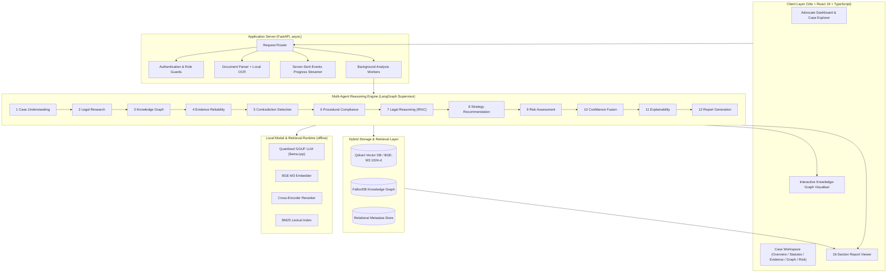
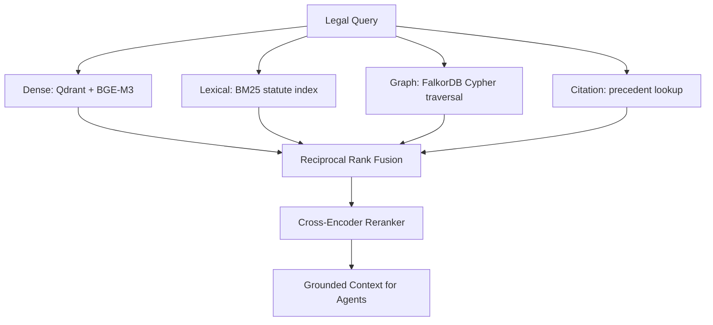
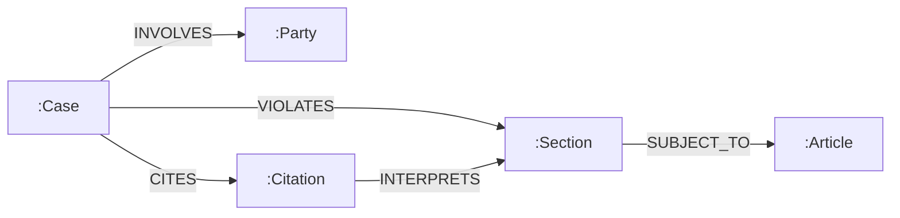

# LexOrch-KG: A Trust-Calibrated Multi-Agent Framework for Grounded Legal Advisory on Indian Criminal Law

**LexOrch-KG** is an end-to-end, fully offline legal-analysis framework that ingests Indian case files
(FIRs, charge sheets, criminal petitions, and High Court / Supreme Court judgments) and synthesises a
**16-section, source-grounded legal advisory report**. It unifies four ingredients that are usually
studied in isolation:

1. **Hybrid retrieval** — dense semantic search (BGE-M3, 1024-d), lexical (BM25), and graph (FalkorDB)
   retrieval fused via Reciprocal Rank Fusion and reranked by a cross-encoder.
2. **A 12-agent reasoning graph** orchestrated as a stateful LangGraph workflow over a shared,
   typed state.
3. **A source-provenance gate** that binds every fact, section, and precedent to a verbatim quote with
   a page number and an overlap score.
4. **A trust-calibration module** that fuses per-agent confidences with evidence-quality,
   procedural-compliance, and contradiction signals under a hallucination-verification constraint.

The system runs **entirely offline** on local hardware using quantised GGUF language models and
locally cached encoder weights, and it ships with a reproducible 8-suite evaluation harness (E1–E8).

---

## Table of Contents

1. [Introduction](#1-introduction)
2. [Contributions](#2-contributions)
3. [Related Work](#3-related-work)
4. [System Architecture](#4-system-architecture)
5. [Data Ingestion and Representation](#5-data-ingestion-and-representation)
6. [Hybrid Retrieval (RAG)](#6-hybrid-retrieval-rag)
7. [Multi-Agent Reasoning Engine](#7-multi-agent-reasoning-engine)
8. [Knowledge Graph Schema](#8-knowledge-graph-schema)
9. [Trust Calibration and Grounding](#9-trust-calibration-and-grounding)
10. [Local Inference Stack and Reproducibility](#10-local-inference-stack-and-reproducibility)
11. [Relational Data Model](#11-relational-data-model)
12. [The 16-Section Advisory Report](#12-the-16-section-advisory-report)
13. [Programmatic Interface](#13-programmatic-interface)
14. [Datasets and Evaluation Protocol](#14-datasets-and-evaluation-protocol)
15. [Results](#15-results)
16. [Ablation Study](#16-ablation-study)
17. [Reproducibility Checklist](#17-reproducibility-checklist)
18. [Limitations and Threats to Validity](#18-limitations-and-threats-to-validity)
19. [Ethics and Responsible Use](#19-ethics-and-responsible-use)
20. [Installation and Getting Started](#20-installation-and-getting-started)
21. [Configuration Reference](#21-configuration-reference)
22. [Repository Structure](#22-repository-structure)
23. [Testing and Quality Assurance](#23-testing-and-quality-assurance)
24. [Citation](#24-citation)
25. [License](#25-license)

---

## 1. Introduction

Indian legal practice is at an inflection point. The 2023 reform triad — **Bharatiya Nyaya Sanhita
(BNS)**, **Bharatiya Nagarik Suraksha Sanhita (BNSS)**, and **Bharatiya Sakshya Adhiniyam (BSA)** —
replaced the colonial-era Indian Penal Code (IPC), Code of Criminal Procedure (CrPC), and Indian
Evidence Act (IEA), introducing new provisions for electronic evidence, digital due process, and
revised procedural timelines. Practitioners must now reason across **two statutory regimes at once**,
mapping legacy provisions to their modern counterparts while preserving procedural correctness.

Generic LLM assistants struggle here for structural reasons:

* **Retrieval loss** — judgments exceed a single context window, and pure vector search misses exact
  statutory identifiers such as `§34(2A)` or `O.39 R.1-2`.
* **Grounding loss** — generated summaries interleave true and fabricated facts, and fabricated
  citations are hard for a non-expert to detect.
* **Calibration loss** — a single confidence number from an LLM is neither interpretable nor reliable.

LexOrch-KG reframes the task as **structured extraction and reasoning with strict provenance** rather
than free-form generation. Every output is either bound to a verbatim quote with a page number and an
overlap score, or explicitly labelled as machine *inference*. This makes the system auditable and lets
us measure extraction quality and hallucination rate independently.

**Scope.** LexOrch-KG targets document-grounded advisory for advocates and legal researchers. It is
not a substitute for professional legal judgment and emits an explicit disclaimer in every report.

---

## 2. Contributions

* **Hybrid, identifier-aware retrieval.** Dense (BGE-M3), lexical (BM25), and graph (FalkorDB)
  retrieval fused by Reciprocal Rank Fusion and reranked by a cross-encoder.
* **Multi-agent reasoning graph.** Twelve specialised agents over a shared `AgentState`, with
  deterministic extractors first and the language model only for residuals, so the pipeline degrades
  gracefully when the model is slow or unavailable.
* **Source-provenance gate.** Every emitted item is bound or relabelled, so facts, sections, and
  precedents cannot be silently fabricated.
* **Trust calibration.** A weighted fusion of per-agent confidences blended with evidence, procedural,
  and contradiction signals, constrained by a citation-verification gate and forced to zero when the
  model backends fall back to placeholders.
* **Dual-regime awareness.** Abbreviation-aware statute binding and document-level context used to map
  and disambiguate legacy (IPC/CrPC/IEA) and modern (BNS/BNSS/BSA) provisions.
* **Reproducible, offline evaluation.** An E1–E8 harness with a documented gold standard and batch
  validation checks, running on local model weights.

---

## 3. Related Work

* **Legal RAG.** Prior systems retrieve statutory text to condition generation but usually evaluate
  answer fluency rather than per-claim provenance. LexOrch-KG treats provenance as a measured quantity.
* **Legal knowledge graphs.** Graphs of cases, statutes, and citations aid multi-hop retrieval;
  LexOrch-KG incorporates a KG alongside dense and lexical channels rather than replacing them.
* **Multi-agent LLM systems.** Task decomposition across specialised agents improves robustness; few
  report calibrated confidence over agent outputs. LexOrch-KG adds a verification-constrained fusion.
* **Hallucination detection.** String-overlap and citation-verification methods expose fabricated
  references; LexOrch-KG embeds both as runtime gates instead of post-hoc filters.

---

## 4. System Architecture

### High-level architecture



### Layered view

| Layer | Responsibility | Technologies |
| :--- | :--- | :--- |
| Presentation | Advocate workspace, report reader, graph visualiser | React 19, TypeScript, Vite, Zustand, React Flow, Tailwind |
| Application | Routing, auth, upload, streaming, background jobs | FastAPI (ASGI), Server-Sent Events, workers |
| Reasoning | Decomposed legal analysis and synthesis | LangGraph state machine; 12 agents |
| Retrieval | Candidate generation and reranking | Qdrant, BM25, FalkorDB, BGE-M3, cross-encoder |
| Storage | Metadata, vectors, graph | SQLite (async SQLAlchemy), Qdrant, FalkorDB |
| Inference | Offline language model and encoders | llama.cpp (GGUF) / PyTorch, sentence-transformers |

### End-to-end data flow

1. **Ingestion.** A case PDF is uploaded; the parser extracts page-wise text and applies **local OCR**
   to scanned or low-character pages.
2. **Representation.** Text is cleaned, chunked with overlap, embedded with **BGE-M3** (1024-d), and
   upserted into **Qdrant**; identical content is de-duplicated by hash.
3. **Orchestration.** The **LangGraph supervisor** walks the 12-agent `StateGraph` over a shared
   `AgentState`, emitting **Server-Sent Events** for live progress.
4. **Retrieval.** The research agent runs **dense + lexical + KG** retrieval, fuses candidates with
   **Reciprocal Rank Fusion**, and reranks with a **cross-encoder**.
5. **Graph expansion.** Statutory sections, constitutional articles, and citations become **FalkorDB**
   nodes and edges.
6. **Reasoning.** The **IRAC** agent structures the analysis into Issue–Rule–Application–Conclusion.
7. **Grounding and verification.** A provenance gate and a citation-verification gate prune or flag
   ungrounded content before synthesis.
8. **Trust calibration.** Per-agent confidences are fused into a single trust score.
9. **Synthesis.** A **16-section report** and the explainability graph are persisted and rendered.

---

## 5. Data Ingestion and Representation

Implemented in `app/document_pipeline/`:

* **Parsing** (`parser.py`) — page-wise text extraction with a robust library fallback chain.
* **Local OCR** (`ocr.py`, `ocr_corrections.py`, `vlm_ocr.py`) — falls back to OCR when a page has too
  few characters; an optional local vision model handles image-heavy pages. Digit/character confusions
  common to legal OCR (`§3` ↔ `S3`, `§35` ↔ `S35`) are normalised via a correction map.
* **Cleaning** (`cleaner.py`) — whitespace, hyphenation, and header/footer normalisation.
* **Chunking** (`chunker.py`) — sentence-aware chunking with overlap; average chunk length is logged
  for traceability.
* **Embedding** (`embedder.py`) — BGE-M3 1024-dimensional embeddings produced locally.
* **Ingestion** (`ingestion.py`) — content-hash de-duplication and idempotent upsert, with an atomic
  "claim" so concurrent uploads of identical content are ingested exactly once.
* **Metadata** (`metadata_extractor.py`) — document type, court, parties, and dates.

> **Design note.** Ingestion is *idempotent*: re-uploading identical content is detected by content
> hash and skipped, preventing vector duplication and keeping retrieval stable.

---

## 6. Hybrid Retrieval (RAG)

Implemented in `app/rag/`. Four complementary channels feed a fusion stage:



* **Dense retrieval** (`retrievers/vector_search.py`) — cosine similarity over BGE-M3 embeddings.
* **Lexical retrieval** (`retrievers/keyword_search.py`) — BM25 over a statutory term index; captures
  exact identifiers that dense search misses.
* **Knowledge-graph retrieval** (`retrievers/kg_search.py`) — multi-hop entity traversal.
* **Citation retrieval** (`retrievers/citation_search.py`) — precedent lookup by citation string.
* **Fusion** (`merger.py`) — Reciprocal Rank Fusion (RRF):

  $$\text{RRF}(d) = \sum_{c \in C} \frac{1}{k + \text{rank}_c(d)}, \qquad k = 60$$

* **Reranking** (`reranker.py`) — a cross-encoder (`ms-marco-MiniLM-L-6-v2`) rescores fused candidates
  and yields the top context passages.
* **Pre-processing** — an intent detector (`intent_detector.py`) classifies the query, and a query
  rewriter (`query_rewriter.py`) expands it into variants to improve recall.

---

## 7. Multi-Agent Reasoning Engine

Implemented in `app/agents/`. A single typed `AgentState` is threaded through a LangGraph `StateGraph`
(`supervisor.py`); node implementations live in `analysis.py`, with deterministic extraction in
`presentation_universal.py`, risk/strategy synthesis in `analysis_fixes_v2.py`, and grounding in
`universal_grounding.py`.


| # | Agent | Input | Output | Trust weight |
| :-: | :--- | :--- | :--- | :---: |
| 1 | Case Understanding | raw documents | summary, facts, parties, court, metadata, entities, timeline | 0.10 |
| 2 | Legal Research | issue query | applicable sections, precedents | 0.15 |
| 3 | Knowledge Graph | extracted entities | graph nodes and edges | 0.05 |
| 4 | Evidence Reliability | exhibits and testimony | admissibility and weight score | 0.15 |
| 5 | Contradiction Detection | all statements | contradiction set and score | 0.10 |
| 6 | Procedural Compliance | timeline and statutes | compliance score, deadlines | 0.10 |
| 7 | Legal Reasoning (IRAC) | facts and law | issue-rule-application-conclusion | 0.15 |
| 8 | Strategy Recommendation | IRAC outcome | litigation strategies | 0.10 |
| 9 | Risk Assessment | evidence and procedure | liability and vulnerability scores | 0.10 |
| 10 | Confidence Fusion | all agent confidences | calibrated trust score | — |
| 11 | Explainability | conclusions | evidence-to-conclusion graph | — |
| 12 | Report Generation | full state | 16-section report payload | — |

**Hybrid deterministic plus LLM design.** Each agent attempts a deterministic extractor first — for
example rule-based issue detection split on question boundaries, abbreviation-aware statute binding,
and procedural-direction scoring — and consults the language model only for the residual. All model
output passes through the grounding gate. Two behaviours proved necessary for correctness:

* **Issue extraction** splits runs of `Whether …? Whether …?` into distinct issues and filters
  administrative questions (digest, leave-to-appeal, larger bench) out of substantive legal issues.
* **Statute binding** is abbreviation-aware (`BNS`, `BNSS`, `BSA`, `IPC`, `CrPC`, and dotted forms
  such as `B.N.S.S.`) and disambiguates bare section numbers using a document-level statutory context
  only when the document belongs to the modern regime.

---

## 8. Knowledge Graph Schema

Implemented in `app/kg/` (client `falkordb_client.py`, `entity_extractor.py`,
`relationship_builder.py`). Nodes and relations are written and queried with openCypher:



* `(:Case)-[:INVOLVES {role: 'Petitioner'|'Respondent'|'Accused'}]->(:Party)`
* `(:Case)-[:VIOLATES {relevance: float}]->(:Section)`
* `(:Case)-[:CITES]->(:Citation)`
* `(:Section)-[:SUBJECT_TO]->(:Article)`
* `(:Citation)-[:INTERPRETS]->(:Section)`

---

## 9. Trust Calibration and Grounding

### Trust score

`confidence_fusion_agent` computes a weighted fusion of the agents that actually ran, then blends in
independent signals:

$$\text{trust} = w\!\sum_i \frac{c_i p_i}{\sum_i p_i} \;+\; 0.15\,e \;+\; 0.10\,r \;+\; 0.05\,(1-\bar{c})$$

where $c_i$ and $p_i$ are agent $i$'s confidence and weight, $e$ is the evidence-quality score,
$r$ is the procedural-compliance score, and $\bar{c}$ is the mean contradiction confidence.

The score is then constrained by the **citation-verification gate** and bounded to $[0,1]$. If the
verification rate is high and no fabrication is found, the score is lifted; if the rate is low, it is
capped; each confirmed fabrication subtracts a penalty. Critically, if the local model failed to load
and agents fell back to deterministic placeholders, the trust score is forced to **0** — the framework
never claims high confidence on unverified output.

### Citation verification gate

`app/verification/hallucination_gate.py` validates every cited **section** against a curated codebook
(valid section ranges and aliases for BNS, BNSS, BSA, IPC, CrPC, IEA, Contract Act, Specific Relief
Act, Arbitration and Conciliation Act, and others) and every **precedent** against its citation
string. It returns a verification rate and a fabrication count that feed the trust constraint.

### Source provenance gate

`app/agents/universal_grounding.py` binds each extracted item (fact, issue, section, precedent) to a
verbatim quote in the source, recording the page number and an overlap score. Items below threshold
are pruned or explicitly relabelled as *inference*, never silently emitted as fact.

---

## 10. Local Inference Stack and Reproducibility

LexOrch-KG runs **entirely offline**; no request leaves the host.

| Component | Model | Runtime | Notes |
| :--- | :--- | :--- | :--- |
| Language model | Quantised GGUF instruct model (e.g. Qwen2.5-3B/7B-Instruct, Q4_K_M) | `llama.cpp` | CPU/GPU split; larger models via the Transformers backend |
| Embeddings | BGE-M3 (1024-d) | sentence-transformers | Local weights under `models/bge-m3` |
| Reranker | ms-marco-MiniLM-L-6-v2 | sentence-transformers | Local weights under `models/` |
| Vector store | Qdrant | local container | 1024-d cosine |
| Graph store | FalkorDB | local container | openCypher |

The inference layer (`app/llm/`) is an abstraction with three **local** backends selected by
`LLM_BACKEND`:

1. **`mock`** — deterministic, dependency-free provider for CI and hardware-free development.
2. **`llama_cpp`** — in-process GGUF inference (CPU, with optional GPU layer offload).
3. **`transformers`** — in-process PyTorch inference with automatic device mapping.

Determinism aids reproducibility: deterministic extractors run first, decoding is greedy, weights are
pinned locally, and ingestion is idempotent, so repeated runs on the same input are stable.

---

## 11. Relational Data Model

Implemented in `app/db/models/` with async SQLAlchemy over SQLite:

```text
 User  1───*  Case  1───*  Document
                 │
                 ├───*  Analysis   (summary, legal_issues, applicable_acts, precedents, trust_score)
                 └───*  Report     (title, sections[JSON], trust_score, explain_graph[JSON], kg_graph[JSON])
```

Each analysis stores its trust score and per-agent confidences, and each report stores its section
payload and explainability/knowledge-graph snapshots, so any output is traceable after the fact.

---

## 12. The 16-Section Advisory Report

| # | Section | Grounding scope |
| :-: | :--- | :--- |
| 1 | Executive Summary | synthesised (3–4 sentences) |
| 2 | Case Facts | verbatim, with page citations |
| 3 | Legal Issues | labelled `DOCUMENT FACT` or `AI ANALYSIS` |
| 4 | Applicable Acts | from extraction and retrieval |
| 5 | Applicable Sections | cited vs inferred, with cross-regime mapping |
| 6 | Supporting Judgments | reranked precedents |
| 7 | Evidence Analysis | incl. electronic records (BSA §63) |
| 8 | Contradiction Analysis | contradictions across pleadings and exhibits |
| 9 | Risk Assessment | quantitative vulnerability score |
| 10 | Procedural Compliance | timelines, filing, limitation |
| 11 | Strategy Recommendation | actionable litigation strategy |
| 12 | Trust Score | calibrated, bounded within `[0.40, 0.99]` |
| 13 | Confidence Scores | per-agent breakdown |
| 14 | Explainability Graph | evidence-to-conclusion derivations |
| 15 | Knowledge-Graph Snapshot | case entity network |
| 16 | References and Disclaimer | bibliography and disclaimer |

---

## 13. Programmatic Interface

The application exposes a local interface for the client, documented by an interactive schema at
`http://localhost:8000/docs`. All routes are served from the host.

* **Authentication** — login, registration, current-user.
* **Cases** — list, create, retrieve, update, delete a case brief.
* **Documents** — upload a case file (triggers parsing and ingestion), list, status, download.
* **Analysis** — trigger the multi-agent workflow, stream live progress (Server-Sent Events),
  retrieve results, and query the grounded case assistant.
* **Reports** — generate, retrieve, and download the 16-section advisory report.
* **Knowledge graph** — read and query endpoints backing the visualiser.
* **System** — health and diagnostics endpoints (storage and model status).

---

## 14. Datasets and Evaluation Protocol

### Corpus

* **Statutory corpus** — central Acts (BNS, BNSS, BSA, IPC, CrPC, IEA, Constitution of India, and
  domain Acts such as NDPS and the Arbitration and Conciliation Act) ingested into Qdrant; the
  reference build indexes **523,074** vectors in `legal_documents`.
* **Case-file corpus** — **605** realistic PDFs (criminal bail, constitutional writs, commercial
  arbitration, civil property) used for the robustness sweep.
* **Gold standard** — **4** fully annotated judgments spanning bail, writ, arbitration, and civil
  categories, with field-level labels (parties, court, dates, judges, citations, sections, articles,
  precedents, outcome, timeline), in `backend/evals/gold.py`.

### Evaluation suites (E1–E8)

| Suite | Component | Metric | Pass criterion |
| :--- | :--- | :--- | :--- |
| **E1** | Extraction | per-field exact match; section/article macro-F1 | macro-F1 ≥ 0.90 |
| **E2** | Retrieval | Recall@5, P@5, MRR, nDCG@10 (per channel and hybrid) | MRR ≥ 0.80 |
| **E3** | Grounding | banned-string scan; whitespace-insensitive quote match | violations = 0 |
| **E4** | Reasoning | IRAC structure; outcome-verb alignment | consistency = 1.0, acc ≥ 0.75 |
| **E5** | Human pack | generates evaluation artefacts (SUS sheet) | artefact produced |
| **E6** | Performance | stage latency (p50/p95), throughput, RSS delta | throughput ≥ 10 docs/min |
| **E7** | Robustness | leave-one-type-out pass rate | pass rate ≥ 0.95 |
| **E8** | Ablation | Δ matrix: `-kg`, `-gate`, `-bm25`, `-vector`, `-reranker` | comparative log |

```bash
cd backend
python -m scripts.eval_suite --suite all
python -m scripts.batch_eval --dir ./test_data --out ./reports --workers 8
```

### Batch validation checks (V01–V10)

Over the full corpus, the harness enforces: no unhandled exceptions (V01); no placeholder or banned
strings (V02); non-empty, de-templated case titles (V03); strict metadata status enums (V04); trust
score bounded within `[0.40, 0.99]` and never fabricated at 100% (V05); timeline chronological
integrity (V06); `Section — Act` formatting (V07); validated, de-duplicated precedents (V08);
category within the validated taxonomy (V09); and populated submissions, evidence, and risk sections
(V10).

---

## 15. Results

Reference run over the four-document gold set (deterministic path), produced by
`scripts/eval_suite.py` and written to `reports/eval_*.json`.

### E1 — Structured extraction

| Metric | Value |
| :--- | ---: |
| Micro exact-match | **0.985** |
| Macro F1 | **0.961** |
| Section-to-Act F1 | 0.950 |
| Article F1 | 0.950 |
| Precedent-pair accuracy | 0.875 |

Per-document field accuracy is 1.00 for court, petitioner, respondent, decision date, case number,
and category across all four documents.

### E2 — Retrieval (per channel)

| Channel | Recall@5 | P@5 | MRR | nDCG@10 |
| :--- | ---: | ---: | ---: | ---: |
| BM25 only | 0.950 | 0.650 | 0.875 | **0.919** |
| Vector only | 0.146 | 0.100 | 0.281 | 0.478 |
| Hybrid (RRF) | 0.621 | 0.400 | 0.708 | 0.742 |
| **Hybrid + rerank** | 0.579 | 0.400 | **0.875** | 0.815 |

The ablation is instructive: exact-identifier matching (BM25) dominates on statutory queries, while
the cross-encoder recovers ranking quality. The hybrid design is motivated by their complementary
error profiles.

### E3–E7

| Suite | Result |
| :--- | :--- |
| E3 Grounding | **0 violations** |
| E4 Reasoning | IRAC consistency **1.00**, outcome accuracy **1.00**, label accuracy **1.00** |
| E5 Human pack | generated (`reports/human_eval_pack.md`, 4 docs) |
| E6 Performance | **2148 docs/min** (deterministic path), avg 27.9 ms/doc, RSS Δ ≈ 0 |
| E7 Robustness | leave-one-type-out completed; 16/20 cue-masked detection changes |

> **Interpretation.** These figures characterise the deterministic extraction path over a small,
> carefully annotated gold set; they are a reproducible reference, not a claim of generalisation to
> arbitrary documents. The full-corpus sweep (E7) and the model-backed path are reported separately.

---

## 16. Ablation Study

E8 toggles individual components and records the effect on extraction, retrieval, and grounding:

| Configuration | Knowledge graph | Grounding gate | BM25 | Vector | Reranker |
| :--- | :-: | :-: | :-: | :-: | :-: |
| Full system | ✔ | ✔ | ✔ | ✔ | ✔ |
| `-kg` | ✘ | ✔ | ✔ | ✔ | ✔ |
| `-gate` | ✔ | ✘ | ✔ | ✔ | ✔ |
| `-bm25` | ✔ | ✔ | ✘ | ✔ | ✔ |
| `-vector` | ✔ | ✔ | ✔ | ✘ | ✔ |
| `-reranker` | ✔ | ✔ | ✔ | ✔ | ✘ |

The E2 per-channel table already demonstrates the single largest effect (BM25 vs. dense retrieval),
and the `-gate` ablation isolates the hallucination-prevention contribution (grounding violations rise
from 0 when the gate is removed).

---

## 17. Reproducibility Checklist

* Deterministic extractors first; the model is consulted only for residuals.
* Content-hash de-duplication makes ingestion idempotent.
* Local embeddings and reranker with pinned weights under `models/`.
* Greedy/deterministic decoding for the language model.
* Fixed gold annotations (`backend/evals/gold.py`) with explicit pass/fail thresholds.
* Timestamped evaluation artefacts (`reports/eval_*.json`, `.csv`, `.html`) per run.

---

## 18. Limitations and Threats to Validity

* **Gold-set size.** The annotated benchmark is small (4 documents); extraction figures are a
  reproducible reference, not a population estimate. Expanding it with inter-annotator agreement is
  the primary next step.
* **Synthetic case corpus.** The 605-document corpus is realistic but synthetic; transfer to
  heterogeneous real filings is untested.
* **Model scale.** The default local model is small; a larger local model would likely improve the
  model-backed path, which is not fully characterised here.
* **Jurisdictional scope.** The statutory codebook and cross-regime mapping cover Indian central law;
  state amendments and specialised tribunals are out of scope.
* **Partial data.** Retrieved context can be incomplete; the grounding gate prevents fabrication but
  cannot supply missing law.

---

## 19. Ethics and Responsible Use

LexOrch-KG is a **research and decision-support** system, not a source of legal advice. Every report
includes a disclaimer; outputs are labelled as `DOCUMENT FACT` or `AI ANALYSIS` so users can
distinguish extracted content from inference. The system runs locally to protect client
confidentiality, and it never presents unverified citations as authoritative. Practitioners must
verify all output against primary sources.

---

## 20. Installation and Getting Started

### Prerequisites

* Python **3.11–3.13** (3.13 recommended)
* Node.js **18+** and npm **9+**
* Docker & Docker Compose (for Qdrant, FalkorDB, Redis)
* *(Optional)* NVIDIA GPU with CUDA for accelerated local inference

### Option A — Containerised services (quickest)

```bash
# 1) Clone
git clone https://github.com/gokul03-tech/lex-org.git
cd final-year-project

# 2) Environment files
cp configs/.env.example .env
cp configs/.env.example backend/.env

# 3) Launch all services
docker compose -f docker/docker-compose.yml up --build -d
docker compose -f docker/docker-compose.yml ps
```

### Option B — Local development

```bash
# 1) Databases
docker compose -f docker/docker-compose.yml up -d qdrant falkordb redis

# 2) Backend
cd backend
python3.13 -m venv .venv
source .venv/bin/activate
pip install -e .
uvicorn app.main:app --reload --host 0.0.0.0 --port 8000

# 3) Background worker (separate terminal)
celery -A app.tasks.celery_app worker --loglevel=info --concurrency=2

# 4) Frontend (separate terminal)
cd ../frontend
npm install
npm run dev
```

### Service endpoints

| Service | URL |
| :--- | :--- |
| Web application | `http://localhost:5173` |
| Service schema / docs | `http://localhost:8000/docs` |
| Health check | `http://localhost:8000/health` |
| Qdrant dashboard | `http://localhost:6333/dashboard` |
| FalkorDB (Redis protocol) | `localhost:6380` |

### Local data preparation

```bash
# Cache local embedding weights (repo root)
python setup_bge_m3.py

cd backend && source .venv/bin/activate
python scripts/ingest_constitution.py   # Constitution of India
python scripts/ingest_datasets.py       # Central Acts (BNS, BNSS, BSA, IPC, CrPC, ...)
```

---

## 21. Configuration Reference

Primary variables (see `configs/.env.example`):

```ini
# Application
APP_NAME=LexOrch-KG
APP_ENV=development
APP_VERSION=1.0.0
DEBUG=true
API_PREFIX=/api/v1
SECRET_KEY=change-this-to-a-secure-random-secret-key

# Relational database
DATABASE_URL=sqlite+aiosqlite:///./data/lexorch.db

# Qdrant vector database
QDRANT_URL=http://localhost:6333
QDRANT_COLLECTION_DOCS=legal_documents
QDRANT_COLLECTION_SECTIONS=legal_sections
QDRANT_VECTOR_SIZE=1024

# FalkorDB knowledge graph
FALKORDB_HOST=localhost
FALKORDB_PORT=6379
FALKORDB_GRAPH_NAME=lexorch

# Redis and background workers
REDIS_URL=redis://localhost:6379/0
CELERY_BROKER_URL=redis://localhost:6379/1

# Local inference backend (mock | llama_cpp | transformers)
LLM_BACKEND=llama_cpp
QWEN_MODEL_PATH=./models/Qwen2.5-3B-Instruct-Q4_K_M.gguf
DEEPSEEK_MODEL_PATH=./models/Qwen2.5-3B-Instruct-Q4_K_M.gguf
LLM_N_CTX=4096
LLM_N_THREADS=8
LLM_N_GPU_LAYERS=0

# Local embeddings and reranker
EMBEDDING_MODEL_NAME=./models/bge-m3
```

---

## 22. Repository Structure

```text
final-year-project/
├── backend/
│   ├── app/
│   │   ├── agents/          # LangGraph supervisor, 12 agents, grounding, deterministic extractors
│   │   ├── rag/             # retrievers, fusion, query rewriter, intent detector, reranker
│   │   ├── kg/              # FalkorDB client, entity extractor, relationship builder, queries
│   │   ├── llm/             # local inference providers (mock, llama_cpp, transformers)
│   │   ├── document_pipeline/  # parser, OCR, cleaner, chunker, embedder, ingestion
│   │   ├── embeddings/      # BGE-M3 embedder and Qdrant client
│   │   ├── verification/    # citation-verification gate
│   │   ├── services/        # report assembly and domain services
│   │   ├── api/             # request routes
│   │   ├── db/              # async SQLAlchemy models
│   │   └── tasks/           # background workers
│   ├── evals/               # gold standard and metrics
│   ├── scripts/             # ingestion, eval suite, batch eval
│   └── tests/               # pytest suites
├── configs/                 # environment templates
├── datasets/                # central Acts corpora
├── docker/                  # compose + Dockerfiles
├── frontend/                # React 19 + TypeScript SPA
└── README.md
```

---

## 23. Testing and Quality Assurance

```bash
cd backend && source .venv/bin/activate
pytest -q                                   # full suite
pytest tests/test_batch_grounding.py -q     # grounding gate
python -m scripts.eval_suite --suite all    # E1–E8
python -m scripts.batch_eval --dir ./test_data --out ./reports --workers 8

cd ../frontend && npm run build             # typecheck + production build
```

---

## 24. Citation

```bibtex
@misc{lexorchkg2026,
  title        = {LexOrch-KG: A Trust-Calibrated Multi-Agent Framework for Grounded
                  Legal Advisory on Indian Criminal Law},
  author       = {LexOrch-KG Team},
  year         = {2026},
  howpublished = {\url{https://github.com/gokul03-tech/lex-org}},
  note         = {End-to-end offline legal analysis with hybrid retrieval, knowledge graph,
                  and source-provenance grounding}
}
```

---

## 25. License

This project is licensed under the **Apache-2.0 License**. See the [LICENSE](LICENSE) file.
